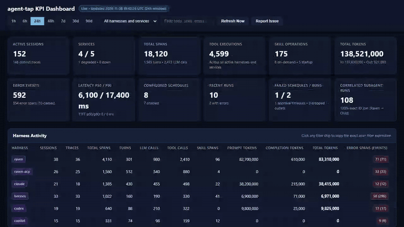
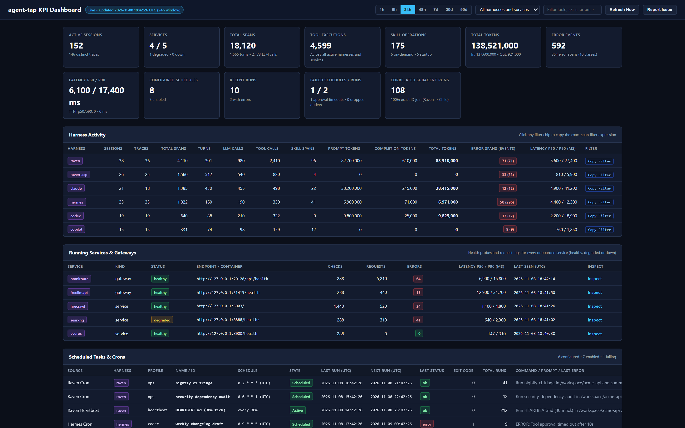
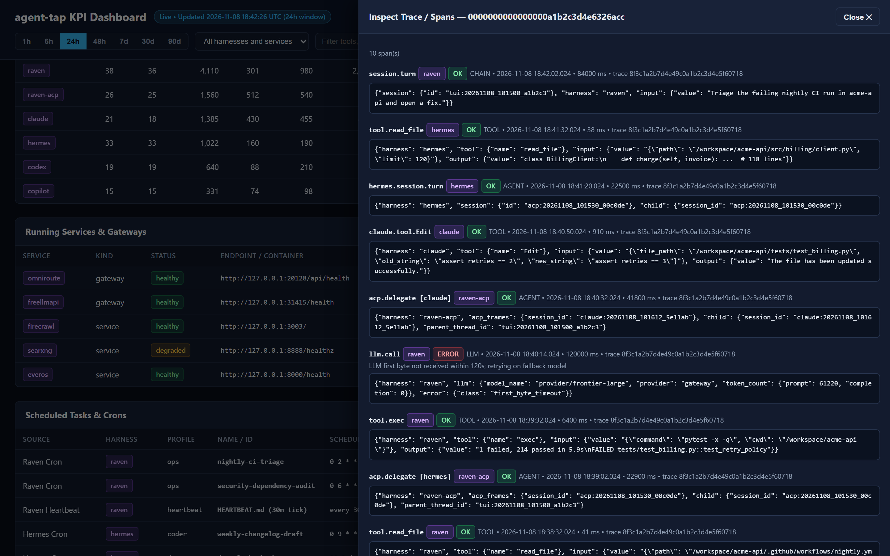

# agent-tap: local observability, usage analytics, and debugging for AI coding agents and local AI services

agent-tap is a local usage analytics, error debugging, trace correlation, and service monitoring tool for AI coding-agent harnesses and running AI services. It reads the logs, databases, and health endpoints that Claude Code, OpenAI Codex CLI, GitHub Copilot CLI, Aider, Cline, Roo Code, LiteLLM, Ollama, vLLM, SearXNG, Firecrawl, and your own services already produce, and stores them in one local SQLite file.

A dashboard at `http://127.0.0.1:6007` shows session usage, token counts, tool latencies, normalized error classes, parent-to-child subagent traces, and scheduled cron runs. Nothing leaves your machine, and prompt text is off by default. In this document, a harness is an AI coding agent program such as Claude Code, Codex CLI, or Copilot CLI.

<p align="center">
  <a href="assets/agent-tap-demo.mp4"></a>
</p>

[Watch the narrated walkthrough (MP4, 48 seconds)](assets/agent-tap-demo.mp4). The data shown is synthetic.

| Harness activity and running AI services | Scheduled tasks and the subagent trace drawer |
|---|---|
|  |  |

## Get started

You need Python 3.11 or later on Linux, macOS, or Windows (including WSL2).

Install from PyPI or run directly with `uvx`:

```bash
pipx install agent-tap
uvx agent-tap
```

You can also install straight from GitHub:

```bash
pipx install git+https://github.com/nareshh74/agent-tap
uvx --from git+https://github.com/nareshh74/agent-tap agent-tap doctor
```

If you use Claude Code, you can install the bundled skill with `/plugin marketplace add nareshh74/agent-tap`.

First, choose which coding agents and local services to monitor:

```bash
agent-tap init
```

`init` scans your machine for coding-agent harnesses and local services, then asks which ones to enable. It pre-selects what it finds. It also asks whether to override any data path and whether to store prompt text (the default is no). The same questions appear on the first `run`, `serve`, or `service install` when no config file exists and a terminal is attached. For scripts, pass `--yes`, `--non-interactive`, or `--harnesses claude-code,codex`. Without a terminal, `init` never prompts.

Now start the collector and the live dashboard:

```bash
agent-tap run --watch       # collect continuously and serve the dashboard
agent-tap serve             # dashboard only
agent-tap service install   # start at login: Task Scheduler, launchd, or systemd --user
```

Open `http://127.0.0.1:6007`. Then check your setup from the terminal:

```bash
agent-tap doctor                 # config, databases, what was found, source health
agent-tap digest --hours 24      # sessions, tokens, tools, skills, errors, schedules
agent-tap query errors --json    # presets: harnesses, errors, tools, sessions, or any read-only SQL
```

## What agent-tap monitors: coding agents, LLM gateways, and local services

Every monitored target is a service with one of three kinds. The kind decides which dashboard sections show it.

| Kind | Examples | Where it appears |
|---|---|---|
| harness | `claude-code`, `codex`, `copilot-cli`, `aider`, `cline`, `roo-code`, or any custom CLI agent | Harness Activity (sessions, turns, tool calls, skill calls, parent-to-child correlation) and every shared section |
| gateway | `litellm`, `ollama`, `vllm`, or any local OpenAI-compatible model proxy | Running Services & Gateways and every shared section |
| service | `searxng`, `firecrawl`, `postgres-pgvector`, and any HTTP endpoint, Docker container, process, or log service you add | Running Services & Gateways and every shared section |

The shared sections are Tool Usage & Latency, Skill Invocations, Crashes, Timeouts & Operational Errors, Scheduled Tasks & Crons, and source health.

Running Services & Gateways lists each non-harness service with its status (healthy, degraded, or down), endpoint or container, request and check counts, error count, p50 and p90 latency, and last seen time.

Common local AI services use these defaults. You can override any of them in `config.toml` or onboard new ones with `agent-tap onboard`.

| Service | Default health endpoint | Docker containers read for request logs |
|---|---|---|
| `litellm` | `http://127.0.0.1:4000/health/liveliness` | `litellm` |
| `ollama` | `http://127.0.0.1:11434/api/tags` | `ollama` (optional) |
| `searxng` | `http://127.0.0.1:8888` | `searxng` |
| `firecrawl` | `http://127.0.0.1:3003` | `firecrawl-api-1`, plus the companion containers for status |

Each probe writes a span with `span_kind` `SERVICE` and the attributes `service.name`, `service.kind`, `service.status`, `service.endpoint`, `http.status_code`, `service.latency_ms`, and `error.class` ([schema](docs/schema.md)).

### Onboard any running service or gateway

Run `agent-tap onboard` (alias `service-add`) with a name, a kind, and at least one source:

```bash
agent-tap onboard --name litellm --kind gateway --health-url http://127.0.0.1:4000/health/liveliness --docker-container litellm
agent-tap onboard --name ollama --kind gateway --health-url http://127.0.0.1:11434/api/tags --process-name ollama
agent-tap onboard --name billing-api --kind service --health-url http://127.0.0.1:9000/health --log-path ~/logs/billing.log
```

The command appends a `[[services]]` entry to `config.toml`. For the full set of keys and for writing a Python adapter, see [docs/writing-a-service-adapter.md](docs/writing-a-service-adapter.md). To add a coding-agent harness that writes JSONL or SQLite logs, see [docs/writing-an-adapter.md](docs/writing-an-adapter.md).

## Dashboard sections

- **Harness Activity** has one row per coding-agent harness with sessions, traces, spans, turns, LLM calls, tool calls, skill calls, tokens, errors, and latency.
- **Running Services & Gateways** has one row per non-harness service or LLM gateway.
- **Scheduled Tasks & Crons** lists Windows Task Scheduler, macOS launchd and crontab, Linux systemd user timers and crontab, plus agent-native cron schedules.
- **Recent Cron & Heartbeat Runs** shows the latest runs with status and duration.
- **Tool Usage & Latency** and **Skill Invocations** rank MCP tools, shell tools, and skills by use, with error rates.
- **Crashes, Timeouts & Operational Errors** groups failures by normalized error class.
- **Parent-to-Child Correlation Explorer** links a parent agent session to the child subagent sessions it started.

Every table sorts when you click a column header. Selecting a row opens the trace drawer with the spans of that trace. The **Report Issue** button in the header opens a pre-filled GitHub issue and copies a diagnostic bundle (see [Report a problem](#report-a-problem)).

## Operational debugging features for coding agents and MCP tools

Usage analytics tell you what your agents and services did. These features tell you why something broke.

- **Normalized error classes.** Each failure gets an `error.class`, so identical failures group together instead of appearing as free text. The adapters emit classes such as these today:
  - Agent orchestration and subagents: `gateway_first_byte_timeout_120s`, `litellm_midstream_fallback_error`, `acp_prompt_timeout_600s`, `subagent_max_tool_rounds_15`, `scheduled_approval_timeout_10s`, `cron_nested_schedule_blocked`.
  - MCP servers and background loops: `mcp_oauth_400_refresh_loop` and `mcp_tool_error`. A five-minute OAuth refresh failure loop collapses into hourly buckets instead of thousands of duplicate rows.
  - GitHub Copilot CLI: `acp_mcp_disposal_race` and `copilot_tool_error`.
  - Claude Code: guardrail blocks such as `claude_sleep_guardrail_blocked`, and tool execution errors.
  - OpenAI Codex CLI: turn errors, `codex_responses_retry_warn`, and upstream `401` authentication classes.
  - LLM gateways: `gateway_http_<status>` (for example `gateway_http_401`, `gateway_http_499`, and `5xx`) and `gateway_circuit_degraded`.
  - Local services: each service adapter reports a down or degraded state with its own `error.class`, for example when a health endpoint times out.
- **Parent-to-child trace correlation across harnesses.** A parent agent session links to its ACP child sessions and to second-degree subagents through ACP frame session ids, Codex `parent_thread_id`, and Claude Code `fork-context-ref`. The correlation explorer shows the tree, and the trace drawer shows each span with secrets redacted.
- **Scheduled task and cron monitoring.** Each schedule shows its last run, next run, exit code, and failures across OS schedulers and agent-native cron jobs.
- **Source health.** Every adapter stage keeps a watermark and a `source_health` row with the last event and the last error. `agent-tap doctor` and the dashboard show them, so a collector that stopped working is visible.
- **SQL on everything.** The data is a plain SQLite file. Query it with `agent-tap query` or any SQLite tool.

## How agent-tap compares to CodeBurn, ccusage, agentsview, Phoenix, and Langfuse

| Feature | agent-tap | CodeBurn | ccusage | agentsview | Phoenix, Langfuse, OpenLIT |
|---|---|---|---|---|---|
| Usage, tokens, cost | Sessions, tokens, tools, and skills. No dollar pricing | Cost estimates, models, and optimization advice | Token and cost reports from local logs | Session browsing and search with analytics | Strong for apps you instrument |
| Error classes from process logs | Yes | No | No | Not its focus | Through your own instrumentation |
| Cross-harness parent-to-child traces | Yes | No | No | Not its focus | Through trace context you propagate |
| Schedule and cron monitoring | Yes | No | No | No | No |
| Running services and LLM gateways | Yes | No | No | No | Through your own instrumentation |
| Local SQLite, no Docker or SDK | Yes | Yes | Yes | Yes | Usually a server or Docker plus an SDK or OTLP exporter |
| New agent or service without code | Yes (TOML and entry points) | No | No | Not its focus | Instrumentation, not log adapters |

The table summarizes what each project usually focuses on and may be out of date. Check each project's documentation, and open an issue if a row is wrong.

agent-tap reads what your coding agents and local services already write to disk, so you get one analytics and debugging view across many different programs without instrumenting them or sending data off your machine.

You can run it next to the other tools:

- Keep CodeBurn or ccusage for dollar estimates and token savings advice. Use agent-tap to find which agent sessions failed, timed out, or looped.
- Keep agentsview to read and search full session transcripts. Use agent-tap for error classes, subagent trace trees, service health, and schedules.
- Use Arize Phoenix, Langfuse, or OpenLIT for the LLM applications you build and deploy. Use agent-tap for the coding agents and local services on your workstation. The span tables have the same shape as Phoenix, so exporting is a SQL query.

## Report a problem

Open an issue with one of the forms in [.github/ISSUE_TEMPLATE](.github/ISSUE_TEMPLATE): a bug report, or a request to support a new service or harness.

Before you file a bug, generate the diagnostics:

```bash
agent-tap bug-report --service firecrawl --error-text "paste the error or traceback here"
agent-tap bug-report --error-file error.txt --output report.md
agent-tap bug-report --open     # opens a pre-filled GitHub issue
```

The report lists your operating system, Python version, agent-tap version, enabled services and harnesses, source health, and recent errors from the agent-tap log. Before it writes anything, it masks secrets with the same rules as span redaction and replaces your home directory with `~`. Read the report before you post it. The dashboard's Report Issue button produces the same bundle.

## Frequently asked questions (FAQ)

**How do I monitor and debug Claude Code, OpenAI Codex CLI, and GitHub Copilot CLI locally?**
Install agent-tap, run `agent-tap init` to pick the harnesses on your machine, then run `agent-tap run --watch`. Open `http://127.0.0.1:6007` for usage analytics and operational errors, or run `agent-tap digest --hours 24` in the terminal. Everything stays in a local SQLite file.

**How do I trace parent-to-child subagents across coding agents?**
agent-tap links a parent session to the child subagent sessions it started (`parent_agent -> child_agent` through ACP session frames, Codex `parent_thread_id`, and Claude Code `fork-context-ref`). Use the Parent-to-Child Correlation Explorer and the trace drawer, or query the `spans` table by `child.session_id`.

**How do I monitor local AI services and gateways such as LiteLLM, Ollama, vLLM, SearXNG, or Firecrawl?**
Select built-in services in `agent-tap init` or add any HTTP endpoint, Docker container, process, or log file with `agent-tap onboard`. agent-tap probes each health endpoint and parses request logs into service spans with status codes and p50/p90 latency.

**How do I debug MCP server errors and OAuth refresh loops across coding agents?**
agent-tap tails both agent session files and daemon error logs, normalizing failures into `error.class` values such as `mcp_oauth_400_refresh_loop`, `acp_mcp_disposal_race`, and `mcp_tool_error`. Repeated failure loops collapse into hourly buckets so you can spot broken MCP servers immediately.

**Is there an open-source complement to CodeBurn and ccusage that also helps with operational debugging?**
Yes. agent-tap does not price tokens in dollars. It adds normalized runtime error classes, parent-to-child trace correlation across harnesses, local service health monitoring, and cron schedule monitoring. Run it next to CodeBurn or ccusage.

**Does agent-tap send my prompts or code anywhere?**
No. It makes no network calls except the local health probes you configure against your own services. Prompt and tool text is dropped by default. To store it locally, set `store_prompt_text = true` or `AGENT_TAP_STORE_PROMPTS=1`. Secret redaction is pattern based, so treat it as best effort ([docs/privacy.md](docs/privacy.md)).

**What does agent-tap need to run?**
Python 3.11 or later and three small dependencies (`platformdirs`, `fastapi`, `uvicorn`). It needs no Docker, database server, API key, or cloud account. Docker is only needed to read the logs of services that run in Docker.

## CLI reference

| Command | Purpose |
|---|---|
| `agent-tap init [--yes\|--non-interactive] [--harnesses h1,h2] [--store-prompts]` | Choose harnesses and services. Alias `setup` |
| `agent-tap onboard --name NAME --kind service\|gateway\|harness [--health-url URL] [--docker-container NAME] [--log-path FILE] [--process-name NAME]` | Add a service to `config.toml`. Alias `service-add` |
| `agent-tap doctor [--json]` | Show config, paths, what was found, and source health |
| `agent-tap run [--once\|--watch]` | Collect once, or continuously with the dashboard. `daemon` is an alias for `run --watch` |
| `agent-tap serve [--port 6007]` | Run the dashboard only |
| `agent-tap query <sql or preset> [--json]` | Run read-only SQL or a preset against the spans database |
| `agent-tap digest [--hours 24] [--json]` | Print a session and error digest |
| `agent-tap prune [--days 90]` | Delete traces older than the window |
| `agent-tap bug-report [--error-text TEXT] [--error-file FILE] [--service NAME] [--open] [--json] [--output FILE]` | Build a diagnostic bundle for a GitHub issue |
| `agent-tap service install\|status\|uninstall\|render [--os windows\|macos\|linux]` | Manage the background service. `render` prints the unit without installing it |
| `agent-tap adapters list\|validate <file.toml>` | List adapters or validate a declarative adapter |
| `agent-tap config show` | Print the effective configuration |

The global flag `--config <file>` selects a config file.

## Configuration

Settings come from four places. Each one overrides the ones after it: command-line flags, `AGENT_TAP_*` environment variables, `config.toml`, and operating system defaults.

`config.toml` lives in the user config directory (`~/.config/agent-tap/` on Linux, `~/Library/Application Support/agent-tap/` on macOS, `%LOCALAPPDATA%\agent-tap\` on Windows). Set `AGENT_TAP_CONFIG` to use another path.

```toml
spans_db = "/path/to/spans.db"
state_db = "/path/to/state.sqlite"
store_prompt_text = false        # AGENT_TAP_STORE_PROMPTS=1 to enable
host = "127.0.0.1"               # AGENT_TAP_HOST
port = 6007                      # AGENT_TAP_PORT
interval = 5.0                   # poll interval in seconds
lookback_hours = 48.0
retention_days = 90
project_name = "agent-analytics"
enabled_services = ["claude-code", "codex", "copilot-cli", "searxng"]   # omit to use everything found
adapters_dir = "~/.config/agent-tap/adapters"                           # declarative harness adapters
wsl_discovery = false            # AGENT_TAP_WSL=1 enables optional WSL2 path discovery on Windows

[paths]                          # data directory overrides, or AGENT_TAP_<NAME>_DIR
codex = "/custom/.codex"

[[services]]                     # one entry per onboarded service or gateway
name = "litellm"
kind = "gateway"                 # harness, gateway, or service
health_url = "http://127.0.0.1:4000/health/liveliness"
docker_container = "litellm"
log_path = "~/logs/litellm.log"
process_name = "litellm"
```

The older key names `enabled_harnesses` and `adapters` still work as aliases for `enabled_services`.

Environment variables: `AGENT_TAP_CONFIG`, `AGENT_TAP_SPANS_DB`, `AGENT_TAP_STATE_DB`, `AGENT_TAP_STORE_PROMPTS`, `AGENT_TAP_HOST`, `AGENT_TAP_PORT`, `AGENT_TAP_WSL`, and `AGENT_TAP_<NAME>_DIR`.

### Where agent-tap looks for harness data

| Harness | Locations checked |
|---|---|
| Claude Code | `~/.claude/projects`, `$XDG_CONFIG_HOME/claude/projects` |
| OpenAI Codex CLI | `$CODEX_HOME` or `~/.codex` |
| GitHub Copilot CLI | `~/.copilot` |
| Aider | `~/.aider*` or project `.aider.chat.history.md` / JSONL logs via `examples/adapters/aider.toml` |
| Cline / Roo Code | VS Code `globalStorage` task history via `examples/adapters/cline.toml` |
| Custom harnesses | Any directory configured in `[paths]`, `AGENT_TAP_<NAME>_DIR`, or `adapters_dir` |

## More documentation

- [Storage schema](docs/schema.md)
- [Privacy](docs/privacy.md)
- [Write a harness adapter](docs/writing-an-adapter.md)
- [Write a service adapter](docs/writing-a-service-adapter.md)
- [Contributing](CONTRIBUTING.md)

## License

MIT
